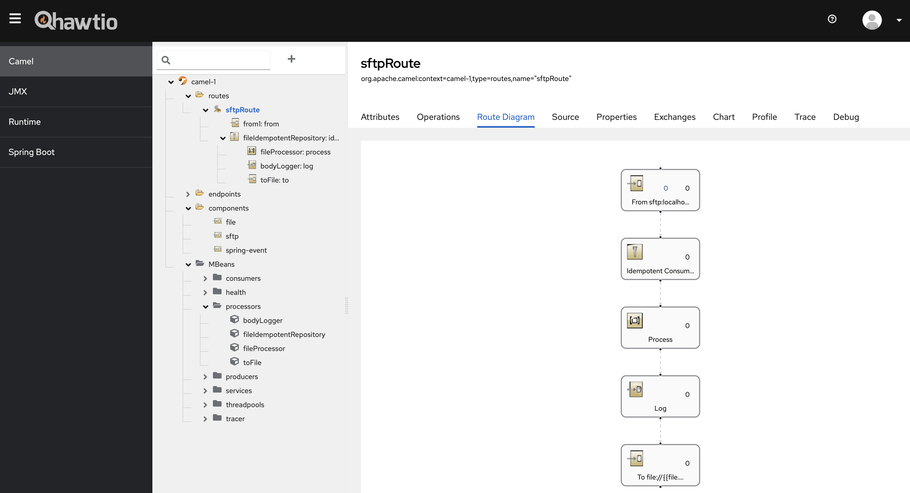

# Spring Boot Camel SFTP Idempotent Consumer Example

**Version:** 2.0.0

This is an example application that copies files from an SFTP server to a local drive. 
The application is designed to only copy files that have not been copied to the local system previously.

## Configuration

The `application.properties` file should be customized to match your environment.
In particular, set `file.output.uri` (the local output directory) and `idempotent.file` (the file that records
already-processed file names so they are copied only once).

## Requirements

* Java 25
* Maven 3.9+
* Spring Boot 4.1.2, Apache Camel 4.23.0, Hawtio 5.3.0

## Hawtio

This application has Hawtio installed to display Camel and Spring information in a web browser. 
You can view this at [http://localhost:8080/actuator/hawtio](http://localhost:8080/actuator/hawtio) as shown below

